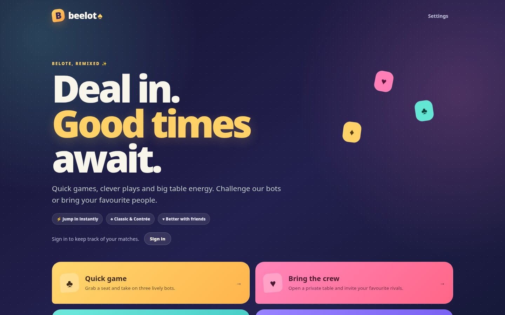
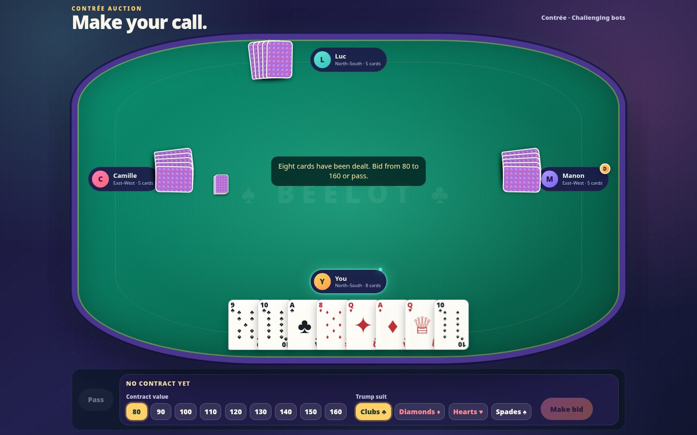

<p align="center">
  
</p>

<h1 align="center">Beelot</h1>

<p align="center">
  <strong>Deal in. Good times await.</strong><br>
  French Belote and Contrée in the browser: against sharp bots, around one device, or online with friends.
</p>

<p align="center">
  <a href="https://github.com/mederel/beelot/actions/workflows/build.yml"></a>
  
  
  
  
</p>

<p align="center">
  
  
</p>

---

## ✨ Why Beelot

| | |
| --- | --- |
| 🃏 **Two games, one table** | Classic Belote with upcard bidding, and Contrée with an 80–160 auction and coinche. |
| 🤖 **Bots worth beating** | Relaxed bots play by the rules of thumb; Challenging bots sample hidden hands and solve them double-dummy before every card. |
| 👥 **Play your way** | Quick games against bots, pass-and-play on one device, private tables for your crew, or public matchmaking. |
| 📊 **Your story in numbers** | Sign in to keep every match: wins per variant and difficulty, contracts, coinches, capots and belotes. |
| 🔐 **No passwords, ever** | Sign in with a passkey, or just play as a guest. No email address asked. |
| 🛡️ **Privacy built in** | GDPR from day one: download or delete your data from Settings, and a clear privacy policy. |
| 🌍 **Speaks your language** | French, English and Dutch, with sound effects and reduced-motion settings. |
| ⚡ **Starts in 50 ms** | Ships as a GraalVM native executable as well as a regular JVM app. |

## 🚀 Quick start

You need **Java 21+** and **Docker** (for MariaDB and the tests). No Gradle install: the wrapper is committed.

```bash
docker compose up -d --wait   # MariaDB on localhost:3306 (database, user and password: beelot)
./gradlew bootRun
```

Then open **[http://localhost:8080](http://localhost:8080)** and deal in.

The database connection can be changed with `BEELOT_DATABASE_URL`,
`BEELOT_DATABASE_USERNAME` and `BEELOT_DATABASE_PASSWORD`. Flyway creates and
migrates the schema (`src/main/resources/db/migration`) at startup.

## 📚 Contents

- [Game modes](#-game-modes)
- [Accounts](#-accounts)
- [Privacy](#-privacy)
- [Verify](#-verify)
- [Bot arena](#-bot-arena) · [Solver benchmark](#-solver-benchmark)
- [Native executable](#-native-executable)
- [Languages](#-languages) · [Sound effects](#-sound-effects)
- [Abuse and memory protection](#-abuse-and-memory-protection)

## 🎮 Game modes

The home screen links to the bot, pass-and-play, private online game, public
matchmaking ("Find a game"), tutorial, and rules routes.

- **Quick game against bots** (`/play/bot`): pick Classic Belote or Contrée,
  Relaxed or Challenging bots, and deal.
- **Pass and play** (`/play/local`) lets two to four people share one device:
  each writes their name in a seat, and bots take the empty ones. Before each
  turn of a different human, a hand-off screen hides every card until that
  player taps "I'm ready". Pass-and-play matches are not recorded in the match
  history.
- **Private tables**: players pick their seats in the lobby before the game
  starts; partners sit across from each other. When the owner starts with
  bots, the bots take the seats left empty.
- **Public matchmaking** seats players at an open table of their variant. The
  game starts when four players are seated, or after
  `beelot.matchmaking.bot-fill-wait` (default 60 seconds) with bots in the
  empty seats; a background sweep checks waiting tables every
  `beelot.matchmaking.sweep-interval` (default 5 seconds).

At private and public tables, seated players can send preset reactions
("Well played!", "Oops!", …) during a match; there is no free text. Each
player may send three reactions in ten seconds, other players see them next
to the sender's seat for a few seconds, and **Settings → Reactions** turns
them off.

Completed tricks are collected automatically. At private and public tables the
server keeps a trick on the table for `beelot.private-table.trick-review`
(default 4 seconds) after a player first loads it, so every player sees it
before it is collected.

The last trick is played automatically: once the seventh trick is collected,
each player's only remaining card is played in turn, and the table reveals the
cards one after the other.

## 🔑 Accounts

Players sign in with a passkey, and nothing else (US-084, ADR-005); guests can
still play every mode. There are no passwords, no email addresses and no
recovery: an account has exactly one passkey, created at sign-up, and losing it
loses the account. The sign-up form says so before the passkey is created.

- **Create an account** creates the passkey and the account at once. The
  account gets a random pseudonym such as "Swift Otter 42", which is also the
  passkey's display name. Registration requires a discoverable credential and
  user verification.
- **Sign in with a passkey** needs no user name: the browser offers the Beelot
  passkey. A passkey synced by the platform (iCloud Keychain, Google Password
  Manager) works on all the player's devices; a player on a new device without
  sync creates a new account.
- Spring Security's WebAuthn support verifies every ceremony, and Beelot
  refuses a sign-in whose signature counter does not go up. Passkeys are
  stored in MariaDB (`user_entities`, `user_credentials`).
- Ceremonies are limited to 30 started per client IP address per hour, sign-ups
  and sign-ins together (`beelot.passkey.limit-per-ip`); beyond that the
  request gets `429`. A failed sign-in gets `401` and never says why.

The relying party is `BEELOT_PUBLIC_URL`, the address players use to reach
Beelot: its host is the passkeys' rp id, and its scheme, host and port the only
origin allowed. It defaults to `http://localhost:8080`, so in development the
rp id is `localhost`, which browsers accept without HTTPS, and
`./gradlew bootRun` needs no configuration. In production, set it to the public
HTTPS address before the first sign-up:

```bash
export BEELOT_PUBLIC_URL=https://beelot.example   # default http://localhost:8080
```

A passkey works only for the rp id it was made for: changing the host later
makes every passkey unusable.

Upgrading from an earlier version deletes every account (Flyway migration V8):
email links, Google and GitHub are gone, and players sign up again. Finished
matches stay in the other players' history, shown as "Deleted player". Back up
the database first.

An account stores the pseudonym, its sign-in dates and the passkey's public
key, signature counter and dates: no name and no email address. When a
match with a signed-in player is won, solo or at a table, it is stored with its
seats, final score and every round (contract, trump, coinche, capot, belote,
points); guests' matches are not stored.
Signed-in players see their results on **My statistics** (`/stats`): matches
won and lost overall, per variant and per solo difficulty, their 20 latest
matches, their team's contracts, coinches, capots and belotes, and its average
points per round. Signing in starts a server session, kept in memory with a new
id; it ends after 7 days without a request and at most 30 days after the
sign-in (US-077). The home screen shows the player's latest other sign-in.
Requests that change state must then echo the `XSRF-TOKEN` cookie in an
`X-XSRF-TOKEN` header, which the web client does.

## 🛡️ Privacy

The privacy policy (`/privacy`, US-083) names who runs Beelot and the services
it relies on. These values come from the environment where Beelot runs; each
one left unset is shown as "not configured" and logged as a warning at startup:

```bash
export BEELOT_PRIVACY_CONTROLLER='Jane Doe'          # the data controller
export BEELOT_PRIVACY_CONTACT=privacy@beelot.example # where players send requests
export BEELOT_HOSTING_PROVIDER='Hosting company'     # who hosts the server and database
export BEELOT_BACKUP_RETENTION_DAYS=30               # days before a backup is overwritten
```

They may also go in a git-ignored `.env` file in the working directory, read as
a properties file, so with the property names: `beelot.privacy.controller`,
`beelot.privacy.contact`, `beelot.privacy.hosting-provider` and
`beelot.privacy.backup-retention-days`.

Players download their data and delete their account in **Settings → Your
data** (US-081, US-082). Deleting needs a sign-in less than 10 minutes old;
finished matches stay in the other players' history, with the deleted
player's seats shown as "Deleted player". Every night at 03:30 UTC
(`beelot.privacy.retention-cron`), Beelot purges security events older than
12 months, deletes accounts without a sign-in for 3 years, and deletes the
passkeys of sign-ups never finished after a day.

Before running Beelot in production:

- Sign a data processing agreement (GDPR article 28) with the hosting provider,
  Beelot's only processor.
- Make sure database backups are overwritten within
  `BEELOT_BACKUP_RETENTION_DAYS` days: the policy promises it, and a deleted
  account lives on in older backups until then.
- Read the [data breach procedure](docs/privacy/data-breach-procedure.md).

## ✅ Verify

```bash
./gradlew test
```

The tests start their own MariaDB container, so Docker must be running.
Every test run also writes a JaCoCo coverage report to
`build/reports/jacoco/test/html/index.html`.

GitHub Actions runs `./gradlew build` on every push to `master` and on every
pull request (`.github/workflows/build.yml`). When it fails, the test reports
are attached to the run as the `test-reports` artifact.

## 🤖 Bot arena

The bot arena measures bot strength by playing two bots against each other on
seeded deals, with no UI. Every deal is played twice with the teams swapping
seats (duplicate format), in classic Belote and in Contrée:

```bash
./gradlew botArena
./gradlew botArena -Pfirst=current -Psecond=random -Pdeals=10000 -Pseed=1 -Pvariant=both
./gradlew botArenaNative -Pfirst=challenging -Psecond=current -Pdeals=1000   # as a native image
```

Available bots are `current` (the Relaxed bot), `challenging` (the
Challenging bot, which searches sampled deals before playing a card), `baseline` (plays its
cards like `current` but bids as bots did before US-050 and US-051: it never
takes in classic Belote and opens 80 in its longest suit in Contrée),
`previous-play` (bids like `current` but plays its cards as bots did before
US-053), `previous-trumps` (plays like `current` but without the trump
management of US-054), `no-coinche` (bids and plays like `current` but never
coinches, as bots did before US-055) and `random` (bids like `current`, then plays a random legal card).
The report gives the average point difference per deal with a 95% confidence
interval, the win rate in
matches to 1,000 points, contract and coinche success rates, the redeal rate,
and the decision time per card. It is printed and written to
`build/reports/bot-arena/report.txt`. The arena is not part of
`./gradlew test`; a short run in `BotArenaTest` is.

Bots decide through a `BotStrategy` (package `fr.beelot.game.bot`), which only
receives its player's view: its own hand and legal cards, the auction, the
contract, and the tricks played so far with the seat that played each card.
Each difficulty level plays its own strategy (`BotStrategies`), and bots at
private and public tables play the Challenging one. Relaxed bots follow
hand-written rules (`RuleBasedStrategy`). Challenging bots (`SamplingStrategy`)
bid like them; to choose a card, they sample deals of the cards they have not
seen, consistent with their hand, the cards played and the voids shown, solve
each sample with `DoubleDummySolver` for every legal card, and play the card
with the best average score. They follow the rules for the first tricks, where
solving takes too long, and stop sampling at their time budget (200 ms by
default). With a fixed seed, their decisions are repeatable as long as the
budget does not cut a search short. To try a new strategy in the arena, add an
`ArenaBot` for it to `ArenaBot.AVAILABLE`.

## 🧮 Solver benchmark

`DoubleDummySolver` finds the best play of a round when all four hands are
known, for bots that search ahead. Its benchmark times it on seeded deals, for
a full round and from the fourth trick:

```bash
./gradlew solverBenchmark                 # on the JVM
./gradlew solverBenchmarkNative           # builds and runs a native image
./gradlew solverBenchmark -Pdeals=200 -Pseed=1
```

## ⚡ Native executable

The app can be compiled ahead of time to a standalone GraalVM native image
(about 50 ms startup, no JVM needed at runtime):

```bash
./gradlew nativeCompile
build/native/nativeCompile/beelot
```

Like the JVM build, it needs the MariaDB database and reads the database
and public URL settings from the environment when it starts.

The build needs a C toolchain (`gcc`, `zlib` headers) and roughly 8 GB of free
memory. It uses a GraalVM 25 toolchain, which Gradle downloads automatically
(via the Foojay resolver in `settings.gradle`) if none is installed. Use
`./gradlew nativeTest` to run the tests as a native image.

## 🌍 Languages

The interface is available in French, English and Dutch. French is the
default; players can switch under **Settings → Language**, and the choice is
remembered. The engine and the French strings live in
`src/main/resources/static/i18n.js`, keyed by the English text; Dutch is in
`i18n-nl.js`. Anything without an entry falls back to English. Messages
generated by the server are translated client-side by the same files.

To add a language, create `i18n-<code>.js` modelled on `i18n-nl.js`, load it
before `i18n.js` in `index.html`, add it to `supportedLanguages` in
`i18n.js`, and add an option to the language selector.

## 🔊 Sound effects

Card dealing, card play, bids, trick and round results, and tutorial answers
have sound effects. They are synthesised in the browser with the Web Audio API
(`src/main/resources/static/sounds.js`), so there are no audio files to ship.
Players can turn them off under **Settings → Sound effects**.

## 🧱 Abuse and memory protection

Game state is held in memory, so the server bounds its own resource use
(defaults live in `src/main/resources/application.properties`):

- **Rate limiting** per client address on `/api/**`
  (`beelot.security.rate-limit.*`): 300 requests/minute overall and 20
  game/table creations, joins or quick matches per minute. Excess requests get `429` with
  `Retry-After`. Behind a reverse proxy, set
  `server.forward-headers-strategy=native` so the real client address is used.
- **Request size**: API bodies over 4 KB get `413` (`beelot.security.max-request-bytes`).
- **Capacity caps**: at most 5000 bot games and 2000 private and public tables
  (`beelot.limits.*`); beyond that creation returns `503`.
- **Idle eviction**: games and tables untouched for 2 hours are removed
  (`beelot.limits.idle-expiry`).
- **Tomcat limits**: thread, connection, timeout and header-size caps.
- Player names are limited to 30 characters.
