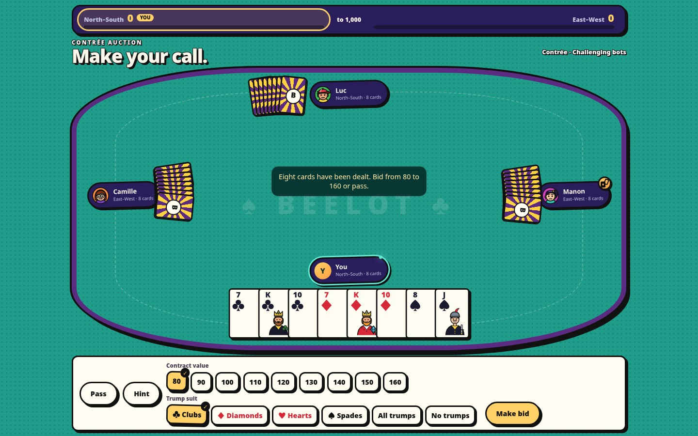

<p align="center">
  
</p>

# Beelot

[](https://github.com/mederel/rubeelot/actions/workflows/build.yml)
[](https://github.com/mederel/rubeelot/releases/latest)


**Deal in. Good times await.** French Belote and Contrée in the browser:
against sharp bots, around one device, or online with friends. It has a bold
cartoon look: a teal felt table, thick ink outlines, chunky sticker-style
buttons and hand-drawn bot characters.

<p align="center">
  
  
</p>

| | |
| --- | --- |
| **Two games, one table** | Classic Belote with upcard bidding, and Contrée with an 80–160 auction and coinche. |
| **Bots worth beating** | Relaxed bots play by the rules of thumb; Challenging bots sample hidden hands and solve them double-dummy before every card. |
| **Play your way** | A "Play now" button that deals a bot game in one tap (classic Belote, announcements on, 1,000 points, relaxed bots, or the choices you last made under "Customise"), pass-and-play on one device, private tables for your crew, or public matchmaking. |
| **Your story in numbers** | Sign in to keep every match: wins per variant and difficulty, contracts, coinches, capots and belotes. |
| **No passwords, ever** | Sign in with a passkey, or just play as a guest. No email address asked. |
| **Privacy built in** | Download or delete your data from Settings, and a clear privacy policy. |
| **Speaks your language** | French, English and Dutch, with sound effects and an effects level (full, reduced or off). |

This repository is Beelot's Rust backend and its frontend.
[ADR-001](docs/adr/001-rust-platform.md) records the decision and
[the design](docs/superpowers/specs/2026-10-23-rust-backend-design.md) the
details.

The other documents are the [product backlog](docs/product-backlog.md), ADR-002
to ADR-005 in `docs/adr/`, the
[data breach procedure](docs/privacy/data-breach-procedure.md), and the feature
specs and plans in `docs/superpowers/`.

## Quick start

The server needs MariaDB; `compose.yaml` starts one with the server's defaults.

```sh
docker compose up -d --wait
cargo run -p beelot-server
```

Then open <http://localhost:8080>. The server applies its database migrations at
startup, serves the frontend from `crates/beelot-server/static/`, and stops
cleanly on Ctrl-C.

## Configuration

The server reads these variables from the environment, or from a `.env` file in
the directory it runs from:

| Variable                         | Default                         | Meaning                                                    |
| -------------------------------- | ------------------------------- | ---------------------------------------------------------- |
| `BEELOT_BIND`                    | `0.0.0.0:8080`                  | the address the server listens on                          |
| `BEELOT_DATABASE_URL`            | `mysql://localhost:3306/beelot` | the MariaDB database                                       |
| `BEELOT_DATABASE_USERNAME`       | `beelot`                        | its user                                                   |
| `BEELOT_DATABASE_PASSWORD`       | `beelot`                        | its password                                               |
| `BEELOT_PUBLIC_URL`              | `http://localhost:8080`         | the address players use: the passkeys' relying party       |
| `BEELOT_TRUST_FORWARDED_HEADERS` | `false`                         | take the client address from `X-Forwarded-For` (behind a proxy) |
| `BEELOT_STATIC_DIR`              | the crate's `static/`           | the frontend's files                                       |
| `BEELOT_PRIVACY_CONTROLLER`      | unset                           | the data controller named in the privacy policy            |
| `BEELOT_PRIVACY_CONTACT`         | unset                           | the privacy contact                                        |
| `BEELOT_HOSTING_PROVIDER`        | unset                           | the hosting provider                                       |
| `BEELOT_BACKUP_RETENTION_DAYS`   | unset                           | how many days backups are kept                             |

The privacy policy shows "not configured" for each privacy value left unset, and
the server lists them in a warning at startup. Logs go to standard output; set
`RUST_LOG` (for example `RUST_LOG=beelot_server=debug`) to change their level.

## Serve over HTTPS

The server only speaks plain HTTP. To serve Beelot over HTTPS, put a reverse
proxy that terminates TLS in front of it, then tell Beelot its public address:

1. Keep the server off the network: `BEELOT_BIND=127.0.0.1:8080`.
2. Set `BEELOT_PUBLIC_URL` to the address players type, for example
   `https://beelot.example`. This is what switches the session cookie to
   `Secure` and fixes the passkeys' relying party, so passkeys registered under
   the old `http://` address stop working: changing the host or scheme means
   registering them again.
3. Set `BEELOT_TRUST_FORWARDED_HEADERS=true` so the rate limits see the player's
   address from `X-Forwarded-For` instead of the proxy's. Only do this when a
   single proxy is the sole way in, otherwise anyone can forge the header. Beelot
   takes the rightmost address of the header, the one that proxy appended, and
   ignores what the client wrote before it.
4. Have the proxy forward to the server. With [Caddy](https://caddyserver.com/),
   which gets and renews the certificate by itself, the whole `Caddyfile` is:

   ```
   beelot.example {
       reverse_proxy 127.0.0.1:8080
   }
   ```

   The domain must point at the machine, and ports 80 and 443 must be open for
   the certificate to be issued. Any other proxy (nginx, Traefik) works the same
   way: terminate TLS, forward to the server and add the client's address to
   `X-Forwarded-For` (nginx: `proxy_set_header X-Forwarded-For $remote_addr;` or
   `$proxy_add_x_forwarded_for`; both work because only the last entry is used).

Passkeys require HTTPS (browsers make an exception for `http://localhost`), so
this is also what makes sign-in with a passkey work on a public server.

## Install from the apt repository

On Debian 13, Ubuntu 24.04 or later (amd64), install Beelot from its signed apt
repository on GitHub Pages; `apt upgrade` then follows the releases.

```sh
sudo install -d -m 0755 /etc/apt/keyrings
curl -fsSL https://mederel.github.io/rubeelot/beelot.asc | sudo tee /etc/apt/keyrings/beelot.asc > /dev/null
sudo tee /etc/apt/sources.list.d/beelot.sources > /dev/null <<'EOF'
Types: deb
URIs: https://mederel.github.io/rubeelot
Suites: stable
Components: main
Architectures: amd64
Signed-By: /etc/apt/keyrings/beelot.asc
EOF
sudo apt update
sudo apt install beelot
```

The package installs the server, its frontend and a `beelot` systemd service
running as the `beelot` user, and recommends `mariadb-server`. It does not create
the database and does not start the service at install, but it enables it: once
configured, it starts at every boot (a start that fails five times in a minute,
for example before the database is set up, is not retried).

1. Create the database and its user in MariaDB (choose your own password):

   ```sql
   CREATE DATABASE beelot;
   CREATE USER 'beelot'@'localhost' IDENTIFIED BY '<password>';
   GRANT ALL ON beelot.* TO 'beelot'@'localhost';
   ```

2. Edit `/etc/beelot/beelot.env`: uncomment `BEELOT_DATABASE_PASSWORD` and set it
   to that password and, if the database is elsewhere, uncomment
   `BEELOT_DATABASE_URL` and set it. The file lists every
   setting of the [configuration](#configuration) table, commented out with its
   default. It holds the password, so only root and the `beelot` group can read
   it; an upgrade never overwrites your edits.
3. Start it: `sudo systemctl start beelot`. The logs are in
   `journalctl -u beelot`. The database tables are created and migrated at
   startup.

The server listens on `127.0.0.1:8080`: put a proxy in front of it, as in
[Serve over HTTPS](#serve-over-https). To remove the package and its settings:
`sudo apt purge beelot` (the `beelot` user and the database are left alone).

## Develop

```sh
cargo fmt --check
cargo clippy --all-targets -- -D warnings
cargo test --workspace
```

The server's database tests start a MariaDB container with Testcontainers, so
Docker must be running. Building the server needs OpenSSL's development files
(`libssl-dev` on Debian and Ubuntu), which `webauthn-rs` links against.

The snapshots the table API sends are pinned by the files in
`crates/beelot-server/tests/contract/`. After an intended change, rewrite them
with `UPDATE_CONTRACT=1 cargo test -p beelot-server --test api_contract` and
review the diff.

The frontend's pure scripts are tested with Node: `node --test crates/beelot-server/frontend-tests/*.cjs`.

The solo table (US-119) and its auction (US-120, a sheet over the table) have a new layout that fits one screen. Open
any page with `?table=legacy` to get the old solo table and bidding view back and `?table=new` to leave them; the choice
is remembered on the device. The flag also brings back the old online table (US-121: the lobby and the cards of private and public tables now share
the solo table). The flag goes with the old views in a later story.

CI measures the tests' coverage with
[cargo-llvm-cov](https://github.com/taiki-e/cargo-llvm-cov), shows it per crate
in the run summary and in a comment on the pull request, and keeps the
`lcov.info` report as the run's `coverage` artifact. To measure it locally:

```sh
cargo install cargo-llvm-cov
cargo llvm-cov --workspace --html --open
```

## Verify

Before a release, check in a browser, with the console open, that these work
without errors:

- a solo Classic game to the end of a round, and a solo Contrée game with a
  coinche;
- pass-and-play with two humans;
- a private table in two browsers: create it, join by code, choose seats, get
  ready, start, play a trick (both update without reloading) and send a
  reaction;
- quick-match in one browser: bots take the empty seats after 60 seconds;
- closing one browser at a private table: its seat shows a bot 2 minutes later;
- passkey sign-up, sign-out and sign-in, statistics after a finished match, the
  data export and the account deletion.

## Release build

```sh
cargo build --release
```

The server is `target/release/beelot-server`. It finds the frontend in the
crate's `static/` folder at the path it was built from; when the binary runs
elsewhere, copy `crates/beelot-server/static/` next to it and point
`BEELOT_STATIC_DIR` at the copy.

### Releases

Every push to `main` that changes more than documentation, and passes the
checks, publishes a release: a `vMAJOR.MINOR.PATCH` tag, a GitHub release and a
workflow artifact holding `beelot-<version>-linux-x86_64.tar.gz` (the server,
its `static/` folder and this README; run it with `BEELOT_STATIC_DIR=static`)
and `beelot_<version>_amd64.deb` (see
[Install from the apt repository](#install-from-the-apt-repository)).
The first release is `v1.0.0`. After that, the version goes up by a minor when
a commit since the previous tag is a feature (its subject starts with `feat:`,
`feat(scope):` or `feat!:`), and by a patch otherwise.
`.github/scripts/next-version.sh` computes it.

### Publishing the apt repository

Each release also builds `beelot_<version>_amd64.deb`, attaches it to the GitHub
release and rebuilds the signed apt repository from every release's package,
deployed to GitHub Pages. This needs a one-time setup:

1. Generate a signing key without an expiry that you keep, with a passphrase, in a
   real terminal (gpg asks for the passphrase through a prompt that needs one):

   ```sh
   export GPG_TTY=$(tty)
   gpg --quick-generate-key 'Beelot apt repository <you@example.org>' rsa3072 sign never
   ```

   If it fails with `agent_genkey failed: End of file` (no terminal, for example in
   an editor's console), have gpg read the passphrase from standard input instead:

   ```sh
   read -rs -p 'Passphrase: ' P; echo
   printf %s "$P" | gpg --batch --pinentry-mode loopback --passphrase-fd 0 \
     --quick-generate-key 'Beelot apt repository <you@example.org>' rsa3072 sign never
   unset P
   ```

   The key's user id is published in `beelot.asc`, so use an address you are happy
   to make public.
2. Add it as repository secrets (Settings, Secrets and variables, Actions):
   `APT_GPG_PRIVATE_KEY`, the output of `gpg --armor --export-secret-keys <key id>`,
   and `APT_GPG_PASSPHRASE`.
3. Set Pages' source to "GitHub Actions" (Settings, Pages).

Without the secrets the `apt-repo` job is skipped with a warning naming the missing
secret; the release still holds the tarball and the `.deb`. To rotate the key, make a new one,
replace the two secrets and publish a release: users then fetch the new
`beelot.asc` again. The workflow's `package` job builds and checks the package and
the repository script on every pull request without any secret.

## Bot arena

The arena plays two bots against each other on seeded duplicate deals: every
deal is played twice with the same cards, once with each bot as North–South,
and the report gives the point difference per deal with its 95% confidence
interval, the matches won, contract and coinche success (and the tout-atout and
sans-atout contracts on their own), and decision times.

```sh
cargo run --release -p beelot-arena -- --first current --second random
```

| Option            | Values                                   | Default                       |
| ----------------- | ---------------------------------------- | ----------------------------- |
| `--first`         | an arena bot                             | `current`                     |
| `--second`        | an arena bot                             | `random`                      |
| `--deals`         | duplicate deal pairs, at least 2         | `10000`                       |
| `--seed`          | the seed the deals are dealt from        | `1`                           |
| `--variant`       | `classic`, `contree` or `both`           | `both`                        |
| `--announcements` | `on` or `off`                            | `on`                          |
| `--all-trumps`    | Contrée tout-atout and sans-atout        | `on`                          |
| `--dealing`       | `shuffled` or `table` (see below)        | `shuffled`                    |
| `--report`        | the report file                          | `target/bot-arena/report.txt` |

Games deal like at a real table: only a match's first deal is shuffled, and
each later deal is cut from the previous deal's gathered tricks. The arena
shuffles every deal pair by default, so that bot strength is measured on
independent hands; `--dealing table` deals each pair from the previous pair's
gathered cards instead.

The arena bots are `current`, `challenging`, `baseline`, `previous-play`,
`previous-trumps`, `previous-all-trumps-play`, `no-coinche`,
`no-announcement-bidding`, `no-all-trumps-bidding` and `random`. The command
prints each variant's report and writes them to the report file.

The bots' tout-atout and sans-atout estimates were fitted on bot play by least
squares. To fit them again:

```sh
cargo run --release -p beelot-arena --bin fit-estimates -- --stage offence --deals 20000 --seed 1
```

`--stage offence` fits the taker's estimate and `--stage defence` the
defence's, which the coinche uses. The command prints each feature's weight
with its standard error and the fit's R²; the rounded weights go into
`crates/beelot-game/src/bot/rule_based.rs`.

## Solver benchmark

The double-dummy solver behind the Challenging bot has its own benchmark:

```sh
cargo bench -p beelot-game --bench solver
```
