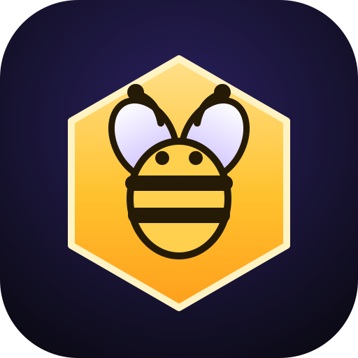
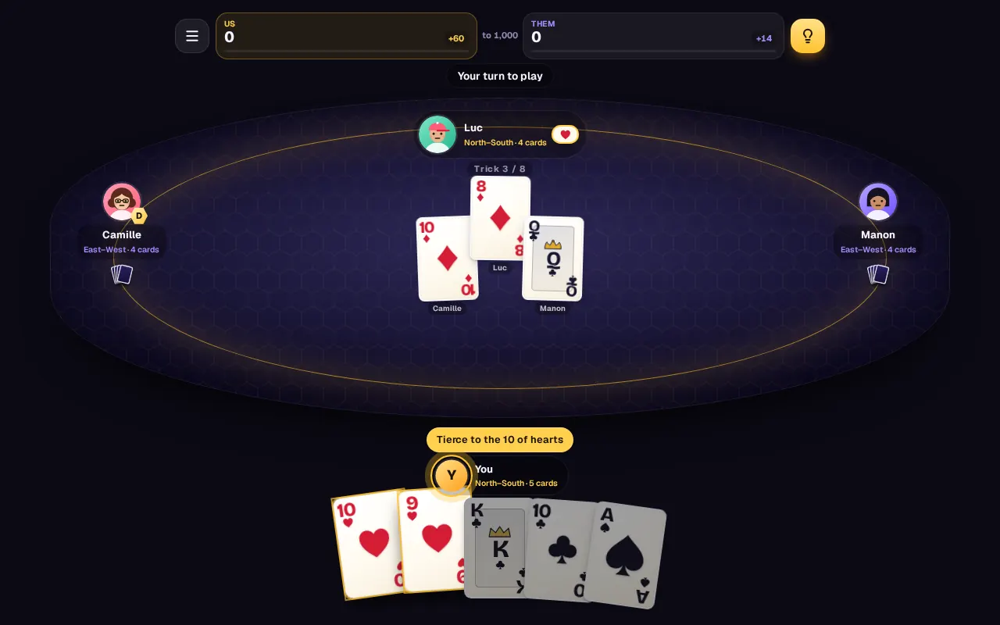
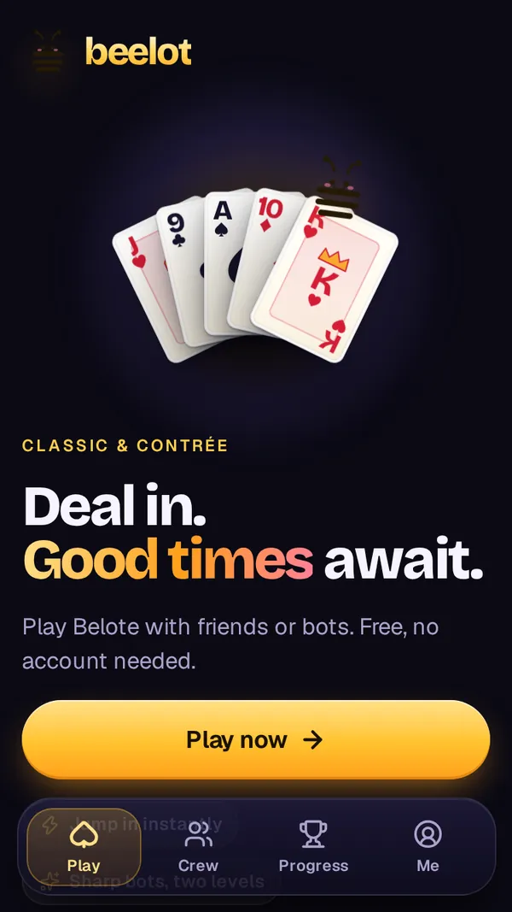
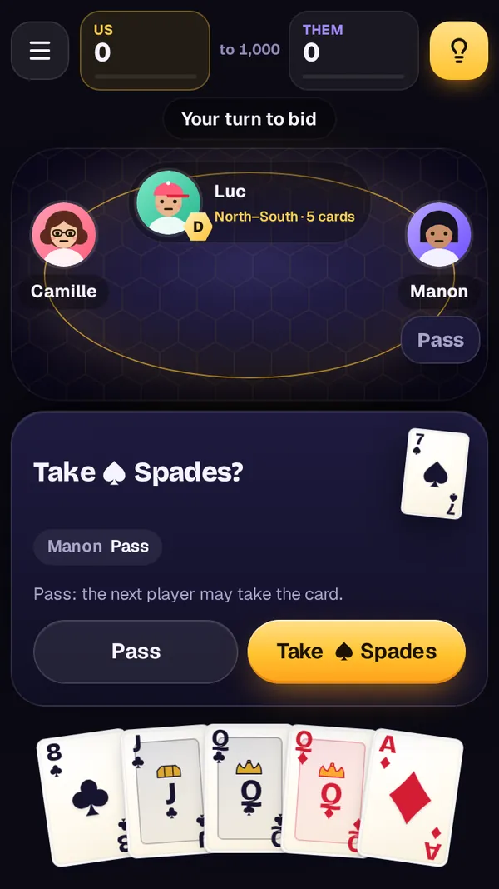
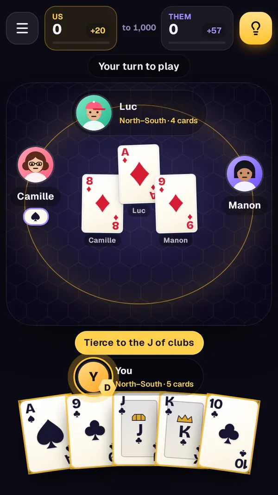
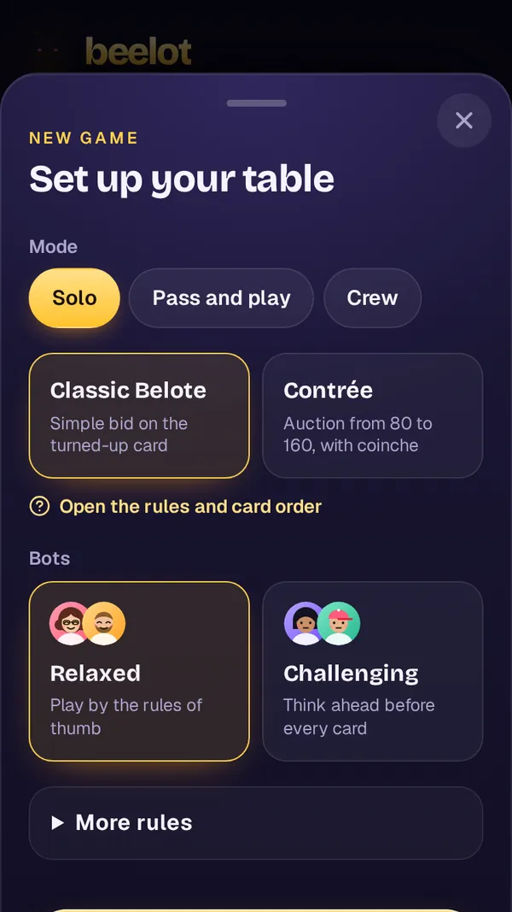

<p align="center">
  
</p>

# Beelot

[](https://github.com/mederel/beelot/actions/workflows/build.yml)
[](https://github.com/mederel/beelot/releases/latest)


**Four seats. One deck. Your table is ready.**

Belote and Contrée in your browser or on Android. Press one button and three bots sit down to play. Or send a code to
your friends. No account. No tracking. No cost. Open source, AGPL-3.0.

**[Meet the game and get it: mederel.github.io/beelot](https://mederel.github.io/beelot/)** ·
**[Read the docs](https://mederel.github.io/beelot/docs/)**

<p align="center">
  
</p>

<p align="center">
  
  
  
  
</p>

## Why you will like it

- **Two games, one table.** Classic Belote with a bid on the turned-up card, and Contrée with an 80 to 160 auction and
  the coinche. A "Play now" button deals a bot game in one tap; "Customise" opens everything else, including
  pass-and-play around one device and match targets from 500 to 2,000 points.
- **Bots with faces.** Camille, Luc, Manon and Hugo have five expressions and comment on the game. Relaxed bots play by
  the rules of thumb. Challenging bots sample the hands they cannot see and solve them double-dummy before every card.
- **Friends and strangers.** Private tables with a six-character invite, public tables where bots fill the empty seats
  after a minute, spectators when the owner allows them, rematches. A bot takes your seat if you leave.
- **Learn, then find out what it cost you.** A tutorial of about three minutes, a rules page, hints, undo, and a
  review of each round that names the cards that cost your team points and why the bots played theirs. A daily deal,
  the same for everyone, with a leaderboard.
- **Your data stays yours.** Guests play every mode. A passkey, with no password and no email address, keeps your
  stats. Download or delete your data from Settings. No analytics; two strictly necessary cookies.
- **Looks the part.** "Honey Night": dark glass, honey gold, seven table themes, synthesised sounds, optional music,
  vibration on phones, an effects level (full, reduced or off). French, English and Dutch, switched on the spot.
- **Everywhere.** Installable from the browser; the rules and the tutorial work offline. An Android app (a Trusted Web
  Activity) that you can build from this repository.
- **Easy to run.** One Rust binary and a MariaDB database. Signed apt and dnf repositories, a multi-architecture
  container image, an Arch PKGBUILD and a Gentoo overlay. Tables survive a restart. Logs, metrics and traces over
  OpenTelemetry, a ready OpenObserve stack, backups, rate limits.

## Quick start

The server needs MariaDB; `compose.yaml` starts one with the server's defaults.

```sh
docker compose up -d --wait
cargo run -p beelot-server
```

Then open <http://localhost:8080>. The server applies its database migrations at
startup, serves the frontend from `crates/beelot-server/static/`, and stops
cleanly on Ctrl-C. It refuses to start until its privacy settings are set: for a
local run, see [Configuration](https://mederel.github.io/beelot/docs/configuration.html).
It also refuses to start, with a message naming `BEELOT_DATABASE_URL`, when that URL does not parse.

## Install on a server

On Debian 13, Ubuntu 24.04 or later (amd64 or arm64), install Beelot from its signed apt
repository on GitHub Pages; `apt upgrade` then follows the releases.

```sh
sudo install -d -m 0755 /etc/apt/keyrings
curl -fsSL https://mederel.github.io/beelot/beelot.asc | sudo tee /etc/apt/keyrings/beelot.asc > /dev/null
sudo tee /etc/apt/sources.list.d/beelot.sources > /dev/null <<'EOF'
Types: deb
URIs: https://mederel.github.io/beelot
Suites: stable
Components: main
Signed-By: /etc/apt/keyrings/beelot.asc
EOF
sudo apt update
sudo apt install beelot
```

The package needs a MariaDB database that you create: [the install guide](https://mederel.github.io/beelot/docs/install.html)
has the next steps, the RPM for Fedora, Rocky Linux and AlmaLinux, the container image, Arch Linux and Gentoo.

## Documentation

The reference lives on the site, one page per topic:

| Page | What it covers |
| --- | --- |
| [Install](https://mederel.github.io/beelot/docs/install.html) | apt, dnf, container image, Arch Linux, Gentoo; updates |
| [Configuration](https://mederel.github.io/beelot/docs/configuration.html) | every variable the server reads, and the privacy settings |
| [HTTPS](https://mederel.github.io/beelot/docs/https.html) | a reverse proxy in front of the server |
| [OpenTelemetry](https://mederel.github.io/beelot/docs/opentelemetry.html) | logs, metrics and traces |
| [OpenObserve](https://mederel.github.io/beelot/docs/openobserve.html) | a ready observability stack |
| [Back up and restore](https://mederel.github.io/beelot/docs/backup.html) | dumps, the packaged timer, restores |
| [Android app](https://mederel.github.io/beelot/docs/android.html) | build, vouch for and publish the app |
| [Table music](https://mederel.github.io/beelot/docs/music.html) | how the loops are composed |
| [Develop and verify](https://mederel.github.io/beelot/docs/develop.html) | build, test and the checks CI runs |
| [Release build](https://mederel.github.io/beelot/docs/release.html) | releases and publishing the apt repository |
| [Bot arena](https://mederel.github.io/beelot/docs/arena.html) | pit the bots against each other |
| [Solver benchmark](https://mederel.github.io/beelot/docs/benchmark.html) | time the double-dummy solver |

The pages are the HTML files in `pages/docs/`, so they also read from a clone of the repository.

## Develop

This repository is Beelot's Rust backend and its frontend. The workspace is in `crates/`; the frontend (Svelte 5,
TypeScript, Tailwind CSS 4, Vite) is in `crates/beelot-server/web/`. Before a pull request, run:

```sh
cargo fmt --check
cargo clippy --all-targets -- -D warnings
cargo test --workspace
```

and, in `crates/beelot-server/web/`, `npm ci && npm run check && npm test && npm run build`. The full guide, with the
frontend's rules, the browser tests and what CI runs, is [Develop and verify](https://mederel.github.io/beelot/docs/develop.html)
(`pages/docs/develop.html`). [ADR-001](docs/adr/001-rust-platform.md) records the choice of platform and
[the design](docs/superpowers/specs/2026-10-23-rust-backend-design.md) the details. The other documents are the
[product backlog](docs/product-backlog.md), ADR-002 to ADR-007 in `docs/adr/`, the
[data breach procedure](docs/privacy/data-breach-procedure.md), and the feature specs and plans in `docs/superpowers/`.

## License

Beelot is free software under the [GNU Affero General Public License, version 3 or later](LICENSE) (AGPL-3.0-or-later).
You may run, study, change and share it. If you run a modified version for others over a network, the licence asks you
to offer them its source. Contributions are accepted under the same licence.
